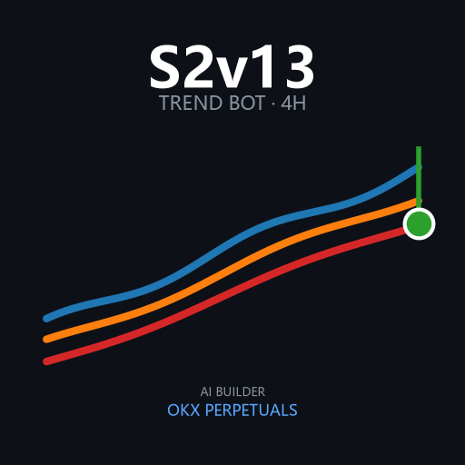
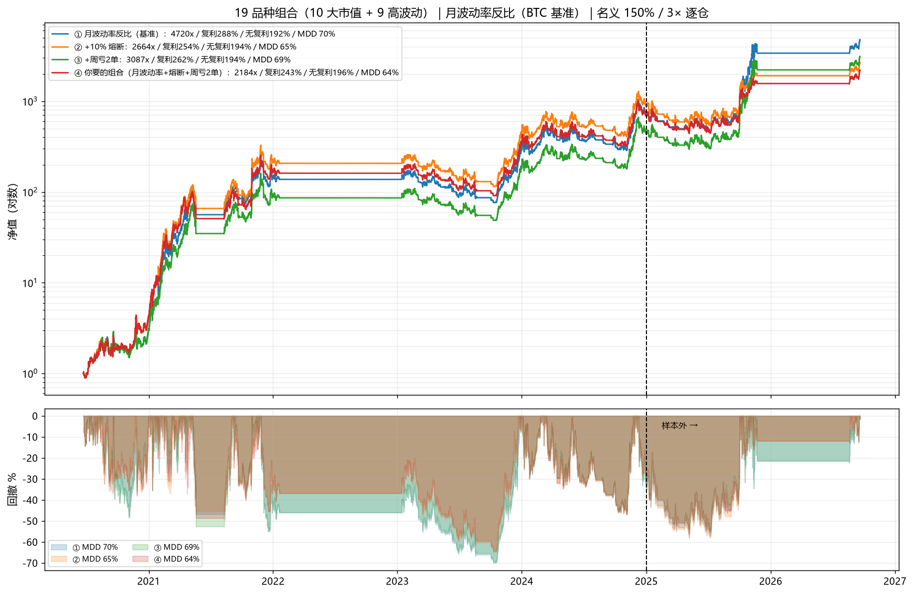
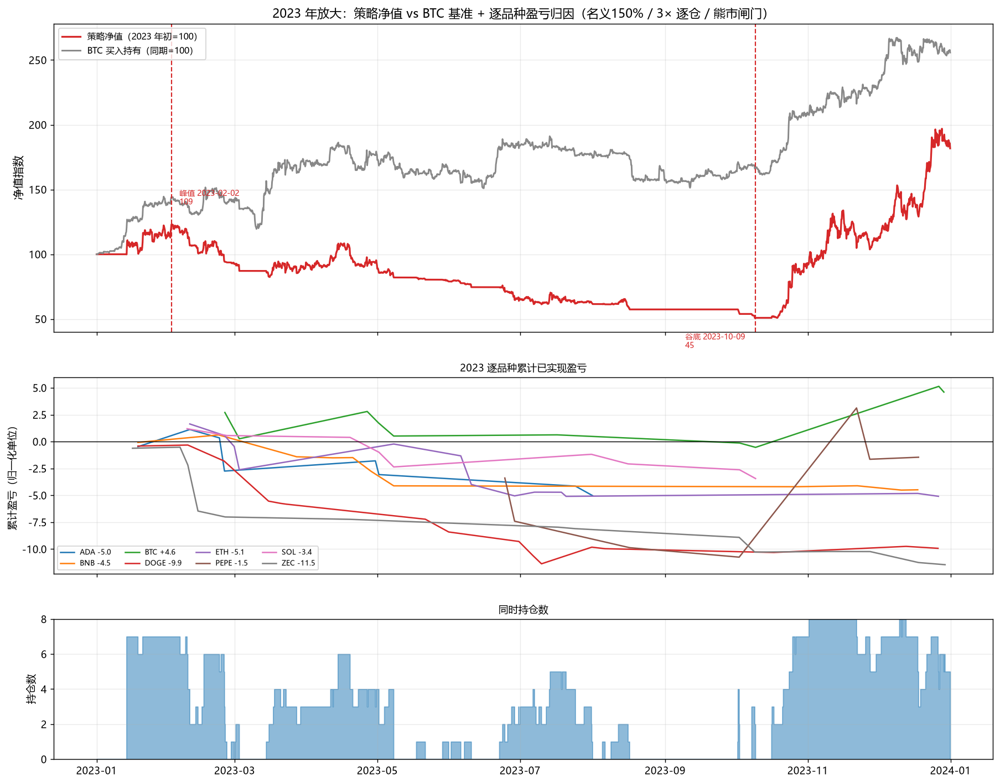
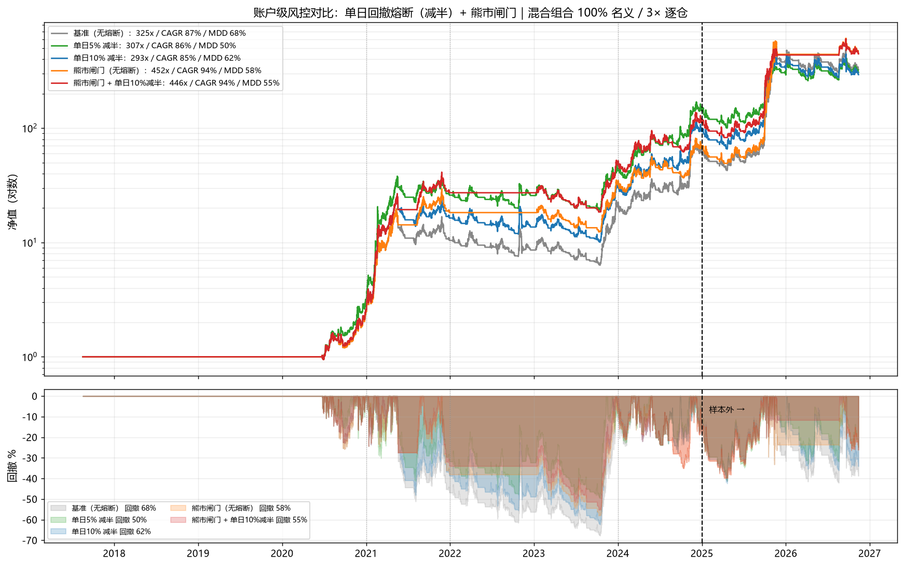

<div align="center">



# S2v13 Trend Bot

**4 小时趋势跟踪交易机器人 · OKX USDT 永续**

三均线排列入场 · 道氏突破（meme 专用） · F3 动态止损 · 波动率反比仓位 · 三层账户风控

</div>

---

## 这是什么

一个可以直接装进 AI Agent 的 **skill 包**，让 Agent 能够：

| 能力 | 说明 |
|---|---|
| 📊 生成信号 | 19 个品种的 4H 交易信号 + 仓位权重表 |
| 🧪 本地模拟盘 | 用真实行情推进，规则与回测完全一致 |
| 🤖 自动下单 | 经 OKX Trade CLI 下单，带止损与 AI Builder 归因 |

## 安装

```bash
npx skills add <your-github-name>/s2v13-trend-bot
```

## 快速开始

```bash
# 1. 生成今日信号（只读，随时可跑）
python skills/s2v13-trend-bot/scripts/signal_engine.py

# 2. 本地模拟盘（真实行情驱动，不碰资金）
python skills/s2v13-trend-bot/scripts/paper_engine.py --init 500

# 3. 实盘下单（默认 dry-run，只打印命令）
python skills/s2v13-trend-bot/scripts/order_engine.py --plan plan.json
```

## 策略逻辑

```
入场  核心：三均线多头排列（EMA_fast > EMA_mid > EMA_slow）且 close > EMA_mid
      meme：道氏破前高 + close > EMA_mid
止损  max( ATR 倍数 , 入场价 × (1 − 回调深度倍数) )   ← 参数见 config
出场  核心：死叉时若浮盈达阈值且仍在长线上方 → 减半；否则全平
      meme：日线趋势线破位
仓位  30 日波动率反比，锚定最低波动品种 = 1.0；名义与杠杆见 config
闸门  熊市不新开 · 回撤后只开长线上方 · 品种分级（广度）
补丁  入场最小持仓期只允许止损 · 每周每品种亏损达上限后停开

> 具体数值（EMA 周期、ATR 倍数、阈值等）不在本仓库，见 `scripts/config.example.json` 结构。
```

## 回测结果

### 净值曲线（19 品种，2017-08 ~ 2026-09）



| 配置 | 终值 | 复利年化 | 无复利年化 | 最大回撤 | Calmar | 样本外 |
|---|---|---|---|---|---|---|
| **月波动率反比（基准）** | **4,720×** | 288% | 192% | 70.0% | **4.11** | +575% |
| +10% 熔断 | 2,664× | 254% | 194% | 65.0% | 3.91 | +201% |
| +周亏 2 单 | 3,087× | 262% | 194% | 69.5% | 3.78 | +604% |
| 全加 | 2,184× | 243% | 196% | 64.3% | 3.78 | +217% |

### 三档口径（诚实起见必须一起看）

| 口径 | 终值 | Calmar | 说明 |
|---|---|---|---|
| 8 品种（含事后精选） | 6,027× | 3.41 | 有选择偏差，**不可复现** |
| 19 品种（公平选择） | 4,720× | 4.11 | 较可信 |
| **品种外样本（13 个新品种）** | **2.84×/个** | **0.52** | **建议按此做真实预期** |

### 最差的一年：2023



2023 年内最大回撤 **−42.7%**，8 个品种 7 个亏损——原因是「BTC 独涨、山寨不涨」。

### 风控：只有三个机制有效



实测 40+ 组风控配置：**只有「周亏限制」「回撤后 EMA200 过滤」「品种分级」有效**，
熔断 / 冷却 / 牛熊判断改进 / 延迟开仓全部负向。

## 目录结构

```
skills/s2v13-trend-bot/
├── SKILL.md                    # skill 入口
├── references/
│   ├── strategy.md             # 策略完整规格
│   ├── backtest-results.md     # 回测结果与证伪清单
│   └── risk-controls.md        # 风控实测结论
├── scripts/
│   ├── signal_engine.py        # 信号（只读）
│   ├── paper_engine.py         # 本地模拟盘
│   └── order_engine.py         # 实盘下单（默认 dry-run）
└── assets/                     # logo 与回测图表
```

## AI Builder 归因

下单命令自动携带 `--aiBuilderCode`：

```bash
okx --profile <profile> swap place \
  --instId BTC-USDT-SWAP --side buy --ordType market --sz 0.01 \
  --tdMode isolated --slTriggerPx 67000 --slOrdPx -1 \
  --aiBuilderCode <YOUR_BUILDER_CODE>
```

**未设置 `OKX_AI_BUILDER_CODE` 时引擎拒绝下单**（fail-closed）。

## ⚠️ 风险提示

- 回测收益不代表未来；品种外样本显示真实 Calmar 只有 **0.5 左右**；
- 预期最大回撤 **40~55%**，可能连续两年不赚钱；
- 本项目**不构成投资建议**，实盘请从小额开始并自行承担风险。

## License

MIT