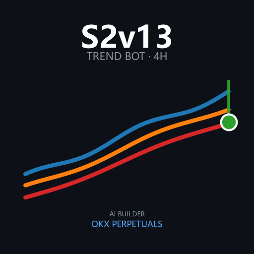

# S2v13 Trend Bot · 4H 趋势跟踪



## 这个 skill 做什么

在 OKX USDT 永续上执行一套**验证过的 4 小时趋势跟踪系统**：

| 能力 | 命令 |
|---|---|
| 生成 19 品种交易信号（只读） | `python scripts/signal_engine.py` |
| 本地模拟盘（真实行情驱动） | `python scripts/paper_engine.py --init 500` |
| 实盘下单（默认 dry-run） | `python scripts/order_engine.py --plan plan.json` |

## 前置条件

1. **OKX Trade CLI** 已安装并配置 profile：`okx config init`
2. **AI Builder Code**（下单归因，可在 https://www.okx.com/agent-tradekit/builder 申请）
   ```powershell
   [Environment]::SetEnvironmentVariable('OKX_AI_BUILDER_CODE','<你的Code>','User')
   ```
3. Python 3.10+ 与 `pandas` / `numpy`

## 策略一句话

> 三条均线排好队、价格站上中线才买；跌破 3×ATR 或回调深度就止损；
> 死叉时如果已经赚了 10% 就只减半；熊市不玩，周内亏两单就歇着。

## 工作流

```
① signal_engine.py  → 输出今日信号 + 权重表（只读，随时可跑）
② paper_engine.py   → 用真实行情推进本地模拟盘，验证规则/记账
③ order_engine.py   → 先 dry-run 打印命令，人工核对后加 --execute
```

## 关键参数

| 参数 | 值 | 说明 |
|---|---|---|
| 周期 | 4H | 信号在每根 4H K 线收盘时计算 |
| 入场（核心 9 品种） | EMA8>EMA100>EMA200 且 close>EMA100 | 三线多头排列 |
| 入场（DOGE/PEPE/ZEC） | 道氏破前高 + close>EMA100 | meme 专用 |
| 止损 | max(3×ATR60, 入场价×(1−1.2×回调深度)) | F3 动态止损 |
| 出场（核心） | 死叉：MFE≥10% 且 close>EMA200 → 减半；否则全平 | HR 规则 |
| 出场（meme） | 日线趋势线破位 | 道氏出场 |
| 最小持仓 | 24 小时 | 防止刚开仓就被洗 |
| 仓位 | 30 日波动率反比，BTC=1.0 基准 | 名义上限 150%，3× 逐仓 |
| 闸门 | BTC<200 日线不开仓；回撤≥20% 只开 EMA200 上方品种 | |
| 补丁 | 同一品种每周亏 2 单后本周停开 | |

## 参考文档

- [`references/strategy.md`](references/strategy.md) — 策略完整规格与逻辑推导
- [`references/backtest-results.md`](references/backtest-results.md) — 回测结果与证伪清单
- [`references/risk-controls.md`](references/risk-controls.md) — 风控设计与实测结论

## 重要提醒

- **回测不等于未来**：品种外样本检验显示，未参与调参的 13 个品种 Calmar 从 1.09 掉到 0.52；
- **预期回撤 40~55%**，且可能连续两年不赚钱；
- **不要手工挑品种**——本策略在 8 个精选品种上 6,027×，在 10 个公平选择的大市值上只有 141×；
- 本 skill **不构成投资建议**，实盘前请用小额验证并自行承担风险。