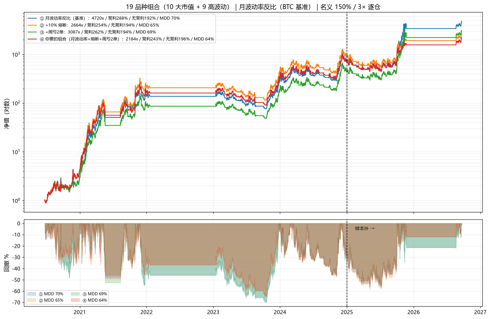
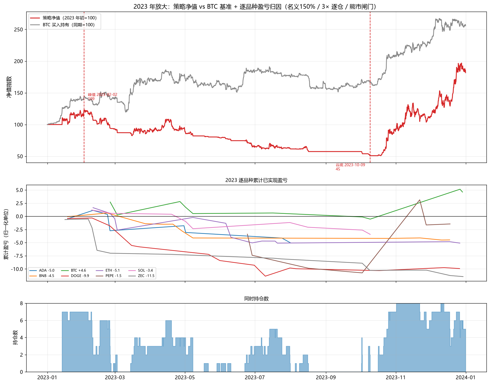

# 回测结果与证伪清单

## 1. 主体结果（19 品种，2017-08 ~ 2026-09）

| 配置 | 终值 | 复利年化 | 无复利年化 | MDD | Calmar | 样本外 |
|---|---|---|---|---|---|---|
| 月波动率反比（基准） | **4,720×** | 288% | 192% | 70.0% | **4.11** | +575% |
| +10% 熔断 | 2,664× | 254% | 194% | 65.0% | 3.91 | +201% |
| +周亏 2 单 | 3,087× | 262% | 194% | 69.5% | 3.78 | +604% |
| +熔断+周亏 | 2,184× | 243% | 196% | 64.3% | 3.78 | +217% |

## 2. 三档口径（必须一起看）

| 口径 | 终值 | Calmar | 说明 |
|---|---|---|---|
| 8 品种（含事后精选的 ZEC/PEPE） | 6,027× | 3.41 | **有选择偏差，不可复现** |
| 19 品种（公平选择） | 4,720× | 4.11 | 较可信 |
| **品种外样本（13 个未用品种）** | **2.84×/个** | **0.52** | **最保守，建议按此做预期** |

## 3. 与 BTC 买入持有对比

| | 策略 | BTC 持有 |
|---|---|---|
| 6 年 | 141×（10 大市值口径） | 18.7× |
| 最大回撤 | 47~57% | −77% |

策略的价值在于用更小的回撤获取现金流，而不是跑赢持有。

## 4. 2023 年归因（最差的一年）

- 2023 年内峰值 2023-02-02 → 谷底 2023-10-09，**−42.7%**（150% 名义口径）
- 8 个品种 7 个亏损，只有 BTC 赚钱（+4.6）
- 根因：**BTC 独涨、山寨不涨**——熊市闸门用 BTC 判断，误放行

## 5. 已证伪清单（40+ 组实测）

| 类别 | 组数 | 结论 |
|---|---|---|
| 单日熔断（清仓 / 减半 / 波动率自适应 / 多阈值） | 12 | 只有 5% 减半有效但代价巨大 |
| 冷却期 / 禁再入场 / 早期 MFE 确认 | 10 | 全部负向 |
| 牛熊判断改进（双均线 / 波动率 / 广度 / 双闸门） | 5 | 全部不如 BTC 200 日线 |
| 高波动品种延迟开仓（120 / 180 / 240 天） | 4 | 2023 有效、2024/25 灾难 |
| 条件式延迟（弱周期 / 假突破市判据） | 6 | 条件不触发或严重误判 |
| 道氏理论做入场（4H / 日线） | 4 | 负向 |

## 6. 数据的坑

- 各品种数据末端不一致 → 持仓被冻结 → 出现假的 −26% 单日回撤；
  修复方法：统一时间轴 + 前向填充（限 3 根）+ 截断到共同末端。
- OKX CLI 一次最多取 300 根 K 线（无分页）→ EMA200 有约 5% 的暖机偏差。