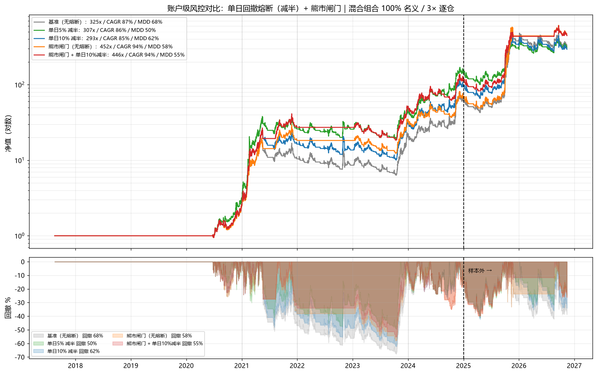

# 风控设计（什么有用、什么没用）

## 有效的三个（已进代码）

| 机制 | 效果 |
|---|---|
| **每周每品种亏 2 单停** | 收益 +4%，回撤不变（唯一免费的） |
| **回撤 ≥20% 后只开 EMA200 上方品种** | MDD −6.8pp，Calmar +13% |
| **品种分级准入（广度门槛）** | MDD −16.8pp，Calmar +34%（最大功臣） |

## 无效的（不要再试）

| 机制 | 为什么无效 |
|---|---|
| 单日熔断（清仓） | 把浮亏变实亏，还错过反弹；3% 阈值一年触发 44 次 |
| 熔断（减半） | 5% 能降 MDD 18pp 但收益只剩 1/6；10% / 15% 形同虚设 |
| 波动率自适应熔断 | 四种校准全部更差 |
| 冷却期 / 禁再入场 | −23% ~ −88% 收益 |
| 双均线（50/200） | 太慢，牛市中期误判为熊 |
| 广度全局闸门 | 山寨 200 日线反复穿越，把建仓窗口关掉 |
| 高波动延迟 180 天 | 2023 有效（+192% / MDD 34%），2024/25 灾难（+35% / +25%） |

## 核心结论

**风控不提高基础收益。** 无复利年化在测试的所有配置里都在 192~198% 之间，
熔断 / 闸门改变的是**复利路径**，不是赚钱能力。

**想提升收益只能靠选品和仓位分配，不靠风控。**